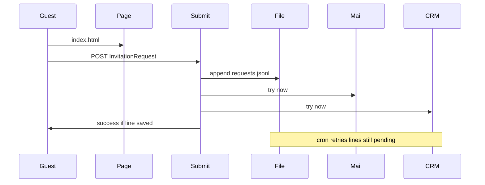

# Лендінг KULIK SYSTEM: HTML + один PHP-файл

Підтверджено. Сторінка — [index.html](index.html), [css/landing.css](css/landing.css), [js/landing.js](js/landing.js). Її віддає звичайний хостинг як статику. Бази даних немає. phpMyAdmin не потрібен.

PHP лишається рівно для форми. ТЗ забороняє слати лист із браузера і вимагає не губити заявку, якщо CRM лежить. Статичний HTML цього не вміє: пароль SMTP і ключ CRM у сторінці були б видимі кожному.

## Документи до коду

- [GLOSSARY.md](GLOSSARY.md): **Guest**, **Invitation Request**, **Delivery**.
- [docs/adr/0001-static-page-file-log.md](docs/adr/0001-static-page-file-log.md): сторінка статична; заявка пишеться у файл, не в MySQL. Обсяг — десятки гостей на одну дату, окрема база нічого не спрощує.

## Сторінка

Тексти живуть прямо в HTML. Окремого шаблонізатора немає.

Порядок блоків за [desktop.png](desktop.png) і [mobile.png](mobile.png):

- Мобільний: Hero, Why, Premiere, Expect, Location, Invitation, підпис KULIK SYSTEM.
- Десктоп: ті самі блоки; Invitation і Location в один ряд.

Блок лікаря в HTML немає, доки організатор не дасть ім’я. Усі CTA скролять до `#invitation`. Get Directions відкриває `https://www.google.com/maps/dir/?api=1&destination=One+Garden+State+Plaza,+Paramus,+NJ+07652`. Посилань на основний сайт немає. `<meta name="robots" content="noindex">`.

Графіка вже є: [assets/hero-evening.jpg](assets/hero-evening.jpg), [assets/premiere-chair.jpg](assets/premiere-chair.jpg), [assets/plaza-dusk.jpg](assets/plaza-dusk.jpg), [assets/icons/](assets/icons/). Поруч покласти WebP. Нижче першого екрана — `loading="lazy"`. Wordmark — CSS, шрифт з диска.

Екран від 320px, без горизонтального скролу. 8 професій з ТЗ.

## Заявка

[submit.php](submit.php) приймає POST. Перевіряє ім’я, email, професію зі списку. Company порожня або текст. Рядок у [storage/requests.jsonl](storage/requests.jsonl) з’являється до листа і CRM. Гість бачить успіх після запису у файл. Помилка не очищає поля. Текст успіху: «Thank You! Your Invitation Request Has Been Received.»

Кожен рядок: id, full_name, email, profession, company, submitted_at, page_url, utm_*, fbclid, і статус кожної доставки (`pending` / `sent` / `failed`). Запис через `flock`. Той самий токен форми другий раз не додає рядок.

Захист: honeypot, мінімальний час заповнення, ліміт з однієї IP, кнопка вимикається на час запиту.

UTM і `fbclid` з URL йдуть у POST.

## Доставки

[config.example.php](config.example.php), реальний [config.php](config.php) у `.gitignore`: SMTP, одержувач, URL CRM (порожній, доки платформу не назвуть), Telegram вимкнений, `GTM_ID`.

- Лист: SMTP з `submit.php`, без Composer і без окремої бібліотеки. Тема `New KULIK SYSTEM Event RSVP — November 3`, поля з розділу 5 ТЗ.
- CRM: якщо URL задано — HTTP з тим самим id заявки і міткою `KULIK_EVENT_NOV_03`. Якщо ні — рядок лишається `pending`, заявка у файлі вже є.
- Telegram не відправляється без bot token і chat id.

[cron/retry.php](cron/retry.php) проходить рядки з `pending` / `failed`. Cron хостингу кожні 5 хвилин, або той самий URL із секретним ключем.

## Аналітика

GTM з `GTM_ID`: скрипт у `<head>`, `noscript` одразу після `<body>`. GA4 і Meta Pixel у код сторінки не ставляться.

У [js/landing.js](js/landing.js): `form_start` на першому фокусі, один раз; `form_submit` лише після відповіді, що рядок збережено.

## Закриття від веба

[.htaccess](.htaccess) закриває `config.php`, `storage/`, `cron/`.

## Перевірка

Відкрити `index.html` як сторінку. Форму перевірити через `php -S`: лист, новий рядок у `requests.jsonl`, один `form_submit`, другий клік не дублює рядок, порожній CRM лишає `pending`, гість все одно бачить успіх.

[docs/admin.md](docs/admin.md): куди заливати теку, які поля в `config.php`, як увімкнути cron. Імпорт SQL не потрібен.
